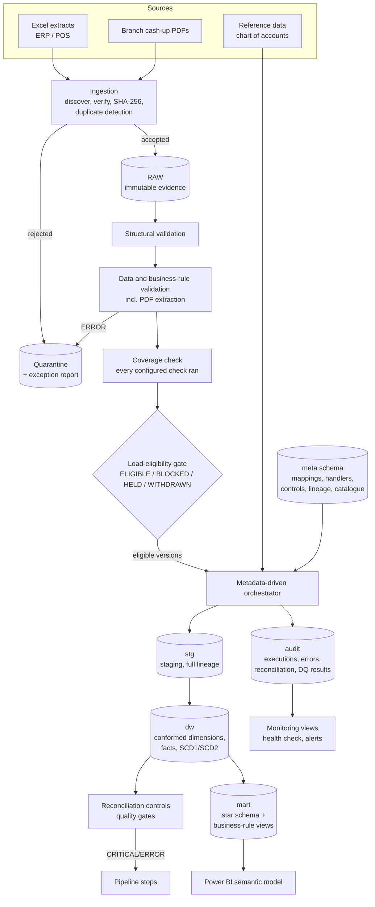

# Architecture

Retail Data Platform v2 turns fragmented operational files from Nawa Retail Group into a governed,
reconciled dimensional warehouse and Power BI-ready marts. Everything runs locally on Windows with
Python and SQL Server 2019; the design maps onto Microsoft Fabric later (see
[fabric_dbt_integration.md](fabric_dbt_integration.md)).

## End-to-end flow

## Layers

| Layer | Where | Purpose |
|---|---|---|
| Incoming | `data/incoming/` | Files as delivered (generated synthetic data in this lab). |
| RAW | `data/raw/<run_id>/` | Byte-for-byte copies; SHA-256 recorded in the ingestion manifest. Never modified. |
| Quarantine | `data/quarantine/<run_id>/` | Copies of rejected or failed files with an `.errors.csv` report. |
| Validation evidence | `logs/*.csv` | Every check, failure, coverage result and gate decision, with validation IDs. |
| Staging (`stg`) | SQL | One table per source, columns derived from the source contract; every row carries run ID, file, file hash and source row number. Append-only per file version. |
| Warehouse (`dw`) | SQL | Conformed dimensions (SCD1/SCD2) and facts at declared grains, with lineage, row hashes and soft deletes. |
| Marts (`mart`) | SQL views | Presentation star schema for Power BI plus business-rule and exception views. |
| Metadata (`meta`) | SQL | Catalogue synchronised from configuration: sources, data dictionary, mappings, handlers, dependencies, controls, business rules, lineage, settings, migrations. |
| Audit (`audit`) | SQL | Pipeline/mapping executions, load and warehouse audits, reconciliation results, actionable errors, validation outcomes, retention actions; monitoring views. |

## Components

| Component | Location | Responsibility |
|---|---|---|
| Source registry | `config/source_registry.yaml` | Source contracts: format, path, staging table, structure, data rules, business rules, PDF extraction, governance, load policy, withdrawals. |
| Pipeline definition | `config/pipeline.yaml` | Mappings, approved handlers, dependencies, reconciliation controls (severity, tolerance), column lineage, freshness, retention. |
| Ingestion | `src/ingestion/discover_files.py` | Discovery, source identification, format and content verification, hashing, duplicate detection, quarantine. |
| Validation | `src/validation/` | Structural and data/business-rule validation, PDF extraction, coverage, load eligibility. |
| Migrations | `sql/NNN_*.sql`, `scripts/migrate.py` | Versioned, checksummed schema changes. |
| Metadata sync | `scripts/sync_metadata.py` | Validates configuration and synchronises the `meta` catalogue. |
| Orchestrator | `src/warehouse/orchestrator.py` | Plans and runs mappings in dependency order with approved handlers, retries and reconciliation gates. |
| Handlers | `src/warehouse/handlers.py` | The approved handler registry: generic staging loader, reference loader, supplier SCD2 runner, one stored procedure per warehouse target. |
| Reconciliation | `src/warehouse/reconciliation.py` | Approved control types (row counts, hash lineage, freshness, key coverage, measure totals, unknown members, SCD2 integrity, ledger balance, supplier checks). |
| Status board | `run_pipeline.bat` → `scripts/run_pipeline.py` | Single command for the whole platform, safe cancellation. |
| Tracing | `scripts/trace_file.py` | Why a file passed or failed, end to end. |
| Health | `scripts/health_check.py` | Alert-ready platform health. |

## Architectural decisions

1. **Configuration is the source of truth; SQL metadata is the runtime catalogue.** YAML in git gives
   review, history and change management; `sync_metadata.py` validates it and loads `meta.*`, logging a
   checksum and the git commit of every sync.
2. **Metadata selects code, never contains it.** Mappings name a handler code. Each code is bound to
   one implementation and one target in `handlers.py`; the orchestrator refuses unknown, unapproved or
   mismatched handlers. Reconciliation parameters that name tables or columns are validated against the
   database and quoted. No SQL or Python is executed from metadata.
3. **Validate before staging, reconcile after loading.** Validation (file level, row level, documents)
   decides eligibility; reconciliation proves each load is complete and correct. Both are evidence,
   stored with IDs that link every result to its run.
4. **One gate decides what may be loaded.** `load_eligibility.py` records, per source and file version,
   ELIGIBLE / BLOCKED / HELD / WITHDRAWN with a reason. The orchestrator stores the exact selection per
   run (`audit.PipelineSourceBatch`); procedures read their batch from there, so a load can never pick
   a different file version than the one approved.
5. **Per-file blocking, critical-source holding.** An invalid cash-up document is excluded while the
   rest loads (PARTIAL). A blocked critical source (general ledger, sites, products) holds everything,
   because partial financial or master data would mislead.
6. **Idempotent, transactional loads.** Staging skips an already-staged file version; warehouse loads
   are MERGEs on business keys with row hashes; every load runs in one transaction under an application
   lock. Re-running after any failure is the recovery procedure.
7. **History is never rewritten silently.** SCD2 for products, customers and suppliers; facts record
   corrections (`audit.FactChangeLog`) and flag records missing from a later full extract
   (`IsDeletedInSource`) instead of deleting them.
8. **Generic where safe, explicit where it matters.** Staging tables and the staging loader are derived
   from the source contracts (one implementation for 19 sources). Warehouse procedures are hand-written
   T-SQL, one per target, because business logic should be readable and reviewable.
9. **Fail loudly and actionably.** Every failure, block and skip is recorded with source, file, row,
   column, rule, actual/expected value, business impact and recommended action, and the steward to
   notify.

## Where to read next

- [warehouse_design.md](warehouse_design.md) - star schemas, grains, SCD and correction handling
- [operations_runbook.md](operations_runbook.md) - running, monitoring, recovering
- [developer_setup.md](developer_setup.md) - set-up, adding a source, tests
- [catalogue/](catalogue/) - generated source catalogue, data dictionary, lineage and rules
