# Warehouse design

Dimensional model in the `dw` schema, exposed to reporting through `mart` views. Column-level lineage
for every table is in [catalogue/mappings_and_lineage.md](catalogue/mappings_and_lineage.md).

## Star schemas

```mermaid
erDiagram
    DimDate ||--o{ FactSales : SaleDateKey
    DimSite ||--o{ FactSales : SiteKey
    DimCustomer ||--o{ FactSales : CustomerKey
    DimPaymentMethod ||--o{ FactSales : PaymentMethodKey
    DimProduct ||--o{ FactSalesLine : ProductKey
    DimDate ||--o{ FactSalesLine : SaleDateKey
    DimSite ||--o{ FactInventoryMovement : SiteKey
    DimProduct ||--o{ FactInventoryMovement : ProductKey
    DimSupplier ||--o{ FactPurchaseOrder : SupplierKey
    DimSupplier ||--o{ FactSupplierInvoice : SupplierKey
    DimSupplier ||--o{ FactSupplierRebate : SupplierKey
    DimAccount ||--o{ FactGeneralLedger : AccountKey
    DimSite ||--o{ FactGeneralLedger : SiteKey
    DimAccount ||--o{ FactOperatingExpense : AccountKey
    DimAsset ||--o{ FactAssetDepreciation : AssetKey
    DimSite ||--o{ FactBranchCashup : SiteKey
```

## Fact tables and grain

| Fact | Grain (one row per...) | Strategy | Key dimensions |
|---|---|---|---|
| FactSales | sales transaction (`sale_id`) | UPSERT | Date, Site, Customer, PaymentMethod |
| FactSalesLine | sales line (`sale_id`, `product_id`) | UPSERT | Date, Site, Customer, Product, PaymentMethod |
| FactInventoryMovement | stock movement (`movement_id`) | UPSERT | Date, Site, Product |
| FactInventorySnapshot | site, product, month end | FULL_REFRESH | Date, Site, Product |
| FactPurchaseOrder | purchase order (`po_id`) | UPSERT | Date, Supplier, Site |
| FactPurchaseOrderLine | PO line (`po_id`, `product_id`) | UPSERT | Date, Supplier, Product, Site |
| FactGoodsReceipt | goods received note (`grn_id`) | UPSERT | Date (receipt and order), Supplier, Site |
| FactSupplierInvoice | supplier invoice (`invoice_id`) | UPSERT | Date (invoice and due), Supplier |
| FactSupplierRebate | supplier and quarter | UPSERT | Date (period end), Supplier |
| FactGeneralLedger | journal line (`journal_id`, line number) | UPSERT | Date, Account, Site |
| FactOperatingExpense | expense (`expense_id`) | UPSERT | Date, Site, Account |
| FactAssetDepreciation | ERP asset and month in service | FULL_REFRESH | Asset, Date, Site |
| FactBranchCashup | cash-up document (`shift_id`) | UPSERT (per document) | Date, Site |
| BridgeProductSupplier | product and approved supplier | SCD1 | Product, Supplier |

Facts of different grains are never joined to each other directly. Analysis across them (for example
sales against cash-ups, or purchases against receipts) aggregates each fact to a common grain through
the conformed dimensions, as the mart views do.

## Dimensions and SCD strategy

| Dimension | Strategy | Why |
|---|---|---|
| DimDate | generated (2020-2030) | Calendar with fiscal periods (`company.financial_year_start_month`). |
| DimSite, DimDepartment | SCD1 | Corrections overwrite; organisational attributes rarely change and history is not needed. |
| DimAccount | SCD1 | Chart of accounts is version-controlled reference data. |
| DimPaymentMethod | static | Seeded reference data. |
| DimProduct | SCD2 | Cost and price history matter for margin analysis. |
| DimCustomer | SCD2 | Customer type and credit limit history. |
| DimSupplier | SCD2 (+ field-level change log) | Minimum order values, rebate rates and terms change over time. |
| DimAsset, DimLocalAsset | SCD1 | As-at attributes; depreciation history is a fact. |

**SCD2 effective dates are load (system) time.** The sources carry no business effective dates, so a
version's `EffectiveFrom` is when the warehouse learned of the change. Facts point at the version that
was current when the fact was loaded ("as loaded"); `IsCurrent` supports "as is" reporting. If sources
add effective dates later, the procedures can switch to business time without changing the model.

## Technical columns (every UPSERT fact and SCD1 dimension)

| Column | Meaning |
|---|---|
| `IngestionRunID`, `SourceFileHash`, `SourceRowNumber` | Exact file version and row the current values came from. |
| `RowHash` | SHA-256 of the business attributes; an unchanged row is never rewritten. |
| `IsDeletedInSource` | The record is absent from the latest full extract (soft delete). |
| `InsertedPipelineExecutionID`, `UpdatedPipelineExecutionID` | Runs that inserted / last changed the row. |
| `InsertedAt`, `UpdatedAt` | System timestamps (UTC). |

Full-refresh tables carry the `PipelineExecutionID` that built them. Staging rows carry the same
lineage plus `LoadedAt`.

## Unknown members and late-arriving data

Every dimension has an Unknown member with key `-1` (the supplier's uses a system batch ID that sorts
before every real batch, so supplier replay protection is unaffected). A fact whose dimension key
cannot be resolved is loaded against `-1` - nothing is silently dropped - and counted in
`audit.WarehouseExecution.UnknownMemberRows`. The `UNKNOWN_MEMBERS` reconciliation control fails the
mapping when that count is above zero, so the cause (late-arriving master data or a wrong key) is
fixed and the fact re-loaded. Because loads are idempotent MERGEs, re-running after the dimension
arrives re-points the fact to the real member.

## Corrections, reversals and removals

The sources are full extracts. Each warehouse load compares the latest eligible version with the
warehouse:

- **Changed record** (correction): the fact row is updated, the old and new row hashes are logged in
  `audit.FactChangeLog` (`UPDATE`). For SCD2 dimensions a new version is created instead.
- **Record missing from the extract** (cancellation/reversal at source): flagged
  `IsDeletedInSource = 1`, logged as `SOFT_DELETE`, excluded from marts, kept for audit.
- **Record that reappears**: restored and logged as `RESTORE`.
- **Accounting reversals** posted as new journals in the ledger are ordinary new facts; journals must
  still balance (`LEDGER_BALANCE` control).
- **Older file after a newer one**: SCD2 procedures refuse to replay an older batch; a controlled
  historical reload is a deliberate operator action.

## Source-system changes

- A new or renamed column fails structural validation (`UNEXPECTED_COLUMN` warning or
  `REQUIRED_COLUMN` error) before anything reaches SQL.
- Contract changes are made in `config/source_registry.yaml`, followed by a new migration (generated
  with `scripts/generate_staging_ddl.py` for new tables, hand-written `ALTER` for existing ones). The
  integration tests compare the live staging schema with the registry, so drift is caught.

## Business-rule views (mart)

| Area | Views |
|---|---|
| Finance | `vw_TrialBalance`, `vw_IncomeStatement`, `vw_BalanceSheet`, `vw_BalanceSheetCheck`, `vw_AccountReconciliation`, `vw_CreditorsAgeing`, `vw_DebtorsCreditExposure`, `vw_SalesProfitability`, `vw_ExpenseAnalysis` |
| Purchasing | `vw_PurchaseOrderCompliance` (minimum order value in NAD), `vw_ThreeWayMatch`, `vw_SupplierPerformance`, `vw_RebateEligibility`, `vw_PurchasingFrequency` |
| Inventory | `vw_StockOnHand`, `vw_ReplenishmentPlan` (reorder point from observed lead times; shortage, excess, slow-moving), `vw_SupplierReorderProposal` (checked against minimum order value) |
| Assets | `vw_AssetRegister`, `vw_AssetDepreciationReconciliation`, `vw_LocalAssetExceptions`, `vw_AssetsBySite` |
| Cash-ups | `vw_CashupReconciliation` (declared vs POS per payment method, variances, missing and quarantined documents) |

Parameters (as-at date, tolerances, safety stock, cover days) come from `meta.Setting`, synchronised
from `config/business_rules.yaml`.

## Known limitations of the source data

- There is no customer-receipt or supplier-payment source: debtor exposure is cumulative credit sales
  and every supplier invoice is open. The views state this.
- Goods receipts carry no quantities, so the three-way match is at document and value level.
- No employee master exists; cashier and asset-holder names are kept as attributes (masked), not as an
  employee dimension.
